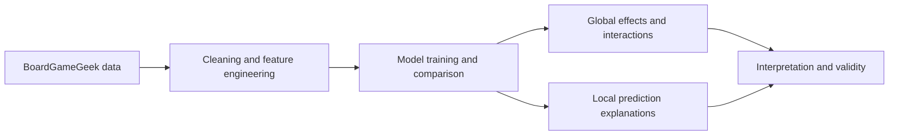
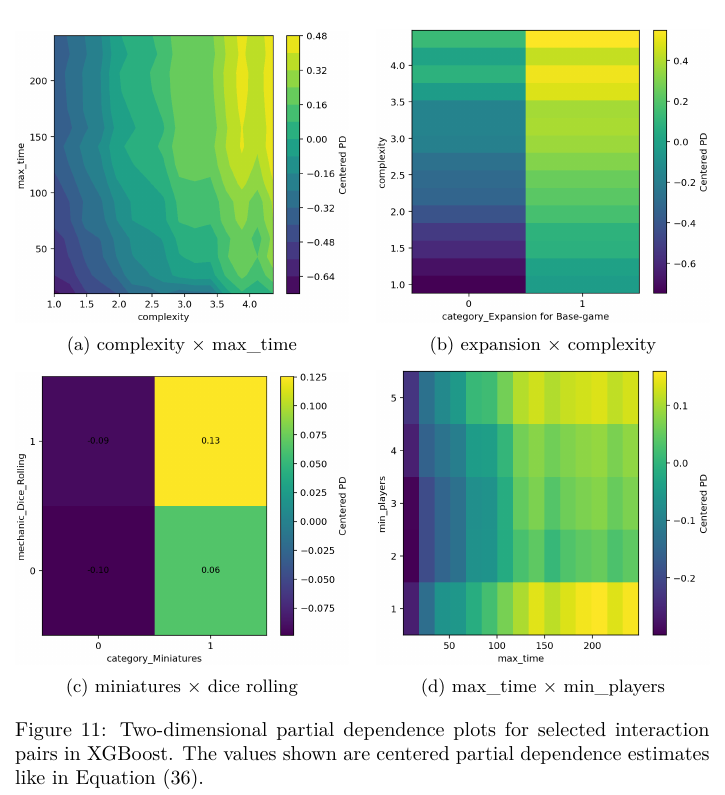

# Model-Agnostic Interpretability
### A Mathematical Approach to Explainable Artificial Intelligence

**Diploma thesis · Moritz Beyer · Leipzig University · December 2025**

How can we understand what a predictive model has learned—and where its explanations can mislead us?

This thesis develops local and global explanation methods within a unified mathematical framework and applies them to predicting BoardGameGeek ratings. The case study connects predictive performance with feature effects, interactions, and the analysis of individual model failures.

**[Read the full thesis →](docs/diploma-thesis.pdf)** · [Results](#results-at-a-glance) · [Explore the code](#explore-the-code) · [Reproduction notes](docs/REPRODUCIBILITY.md)

| Dataset | Model comparison | Best reported test result |
| :--- | :--- | :--- |
| **61,530** board games | **7** predictive models + a mean baseline | **0.628 RMSE · 0.667 R²** (XGBoost) |

## What this project covers

- **Mathematical foundations:** consistent definitions and key properties of CP/ICE, Shapley-based attribution, PDP, ALE, permutation importance, and feature interaction measures.
- **Applied machine learning:** data preparation, feature engineering, linear models, tree ensembles, neural networks, Optuna-based hyperparameter optimization, and MLflow experiment tracking.
- **Model understanding:** global feature importance and effects, Friedman’s H-statistic, two-dimensional partial dependence, and local CP/SHAP explanations.
- **Critical interpretation:** correlated features, selection effects, proxy variables, anomalous metadata, and the limits of explanations.

The contribution is the mathematical synthesis and empirical analysis of established methods, rather than a new explanation algorithm.

## From data to explanations

The thesis describes 388 features, including two identifiers excluded from model inputs: **13 numerical and 373 boolean predictors**. The target is the average user rating on a 1–10 scale.

## Results at a glance

Reported test-set results from **Chapter 5, Table 1** of the thesis. These are the published experimental results, not a fresh benchmark run of this repository.

| Model | RMSE ↓ | MAE ↓ | R² ↑ |
| :--- | ---: | ---: | ---: |
| **XGBoost** | **0.628** | **0.452** | **0.667** |
| Random Forest | 0.644 | 0.462 | 0.649 |
| AdaBoost | 0.659 | 0.477 | 0.633 |
| Neural network (NN3) | 0.689 | 0.514 | 0.599 |
| Neural network (NN1) | 0.706 | 0.522 | 0.578 |
| Linear Regression | 0.766 | 0.576 | 0.505 |
| Lasso Regression | 0.776 | 0.584 | 0.491 |
| Mean baseline | 1.088 | 0.871 | 0.000 |

NN1 denotes the shallow network; NN3 is the thesis label for the network with two hidden layers and a dropout layer.

### What the explanations reveal

**Consistent global patterns.** Publication year, complexity, and expansion status are prominent predictors across model classes. Roll-and-move mechanics show a consistently negative association with predicted ratings.

**Context-dependent effects.** The interaction analysis examines how effects change with other features—for example, complexity with play time and expansion status with complexity.

*Figure 11 from the thesis (printed page 45): centered two-dimensional partial dependence for selected XGBoost interactions.*

**Explanations also expose failures.** Local analyses examine overprediction of *Dominion: Fan-Edition I* and the large prediction error for *Rock Paper Scissors Game*, illustrating proxy effects and gaps in the available feature representation.

These findings describe fitted models and the BoardGameGeek rating ecosystem. They are **not causal effects or population-wide preference estimates**; community selection, dependent features, and metadata quality affect interpretation. See Chapter 5.3 for the discussion.

## Explore the code

| Area | Purpose | Suggested entry points |
| :--- | :--- | :--- |
| [Data preparation](Data%20Preparing/) | Cleaning, feature engineering, and collinearity analysis | [Cleaning](Data%20Preparing/data_cleaning.py), [VIF analysis](Data%20Preparing/calc_VIF_scores.py) |
| [Machine learning](Machine%20Learning/) | Training experiments and hyperparameter optimization | [XGBoost + Optuna](Machine%20Learning/XGBoost_Optuna.py), [fixed split loader](Machine%20Learning/data_utils.py) |
| [Case study](Case%20Study/) | Model comparison and explanation analyses | [Model training](Case%20Study/model_training.py), [evaluation](Case%20Study/model_performance.py) |
| [Global explanations](Case%20Study/) | Feature importance, effects, and interactions | [PFI](Case%20Study/PFI.py), [ALE](Case%20Study/ALE_clean.py), [pairwise H-statistic](Case%20Study/calculate_H_pairwise.py) |
| [Local explanations](Case%20Study/) | Instance-level prediction analysis | [CP/SHAP explanations](Case%20Study/Generate_local_explainers.py) |
| [Scraper](Scraper/) | Data acquisition tooling | [Scraper documentation and upstream attribution](Scraper/README.md) |

**Technology:** Python · pandas · NumPy · scikit-learn · XGBoost · TensorFlow/Keras · Optuna · MLflow · SHAP · Matplotlib

## Reading guide

- **For a quick overview:** Chapter 1, Chapter 5, and Chapter 6.
- **For the mathematics:** Chapters 2–4 cover foundations, local explanations, and global methods.
- **For the empirical details:** Chapter 5 and the appendices contain model results, explanation plots, and supporting tables.

## Running the research code

This repository contains the research scripts and artifacts accompanying the thesis. Large CSV and pickle files are managed with **Git LFS**. Environment exports are included, but some scripts retain machine-specific paths and experiment-specific settings; the repository is not yet a one-command reproduction package.

See **[reproduction notes](docs/REPRODUCIBILITY.md)** for setup, entry points, and known limitations before running experiments.

## Attribution

The thesis is by **Moritz Beyer**, supervised by **Dr. Iryna Okhrin** at Leipzig University.

The `Scraper/` directory includes the [Board Game Scraper](https://gitlab.com/recommend.games/board-game-scraper) project by Markus Shepherd / Recommend.Games. Its original documentation and [MIT license](Scraper/LICENSE) are retained. That component’s license does not establish a license for the thesis or the entire repository.

Data originates from [BoardGameGeek](https://boardgamegeek.com/). Acquisition and preprocessing are described in Appendix A of the thesis.
